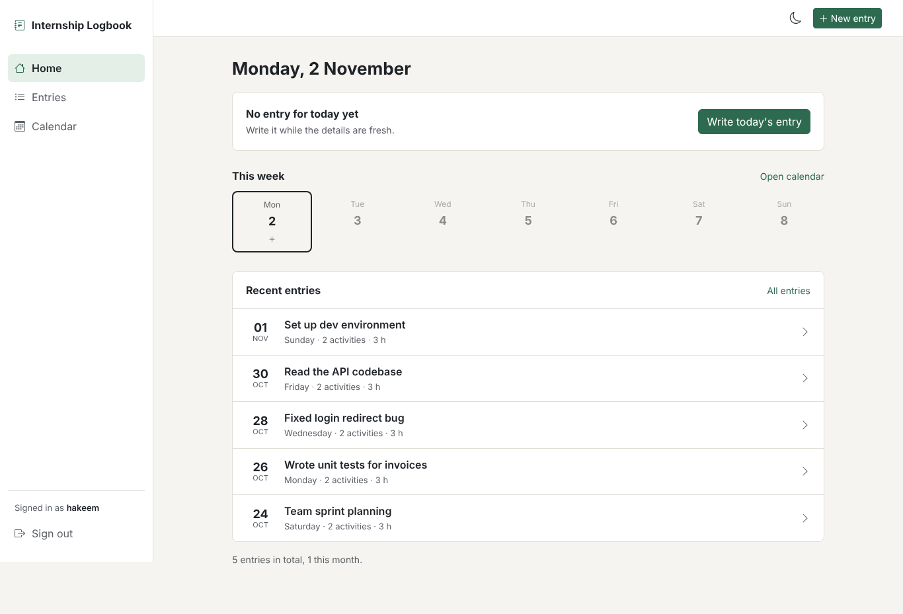
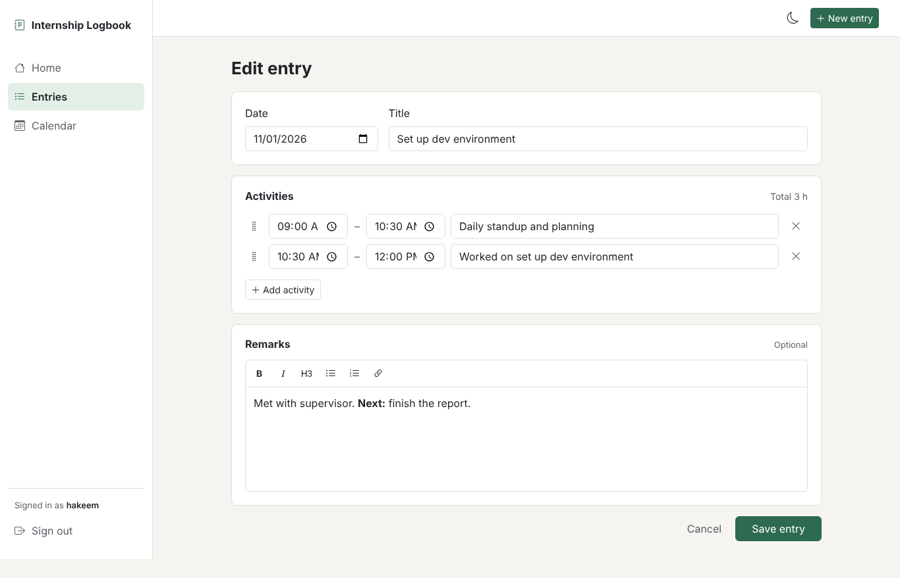
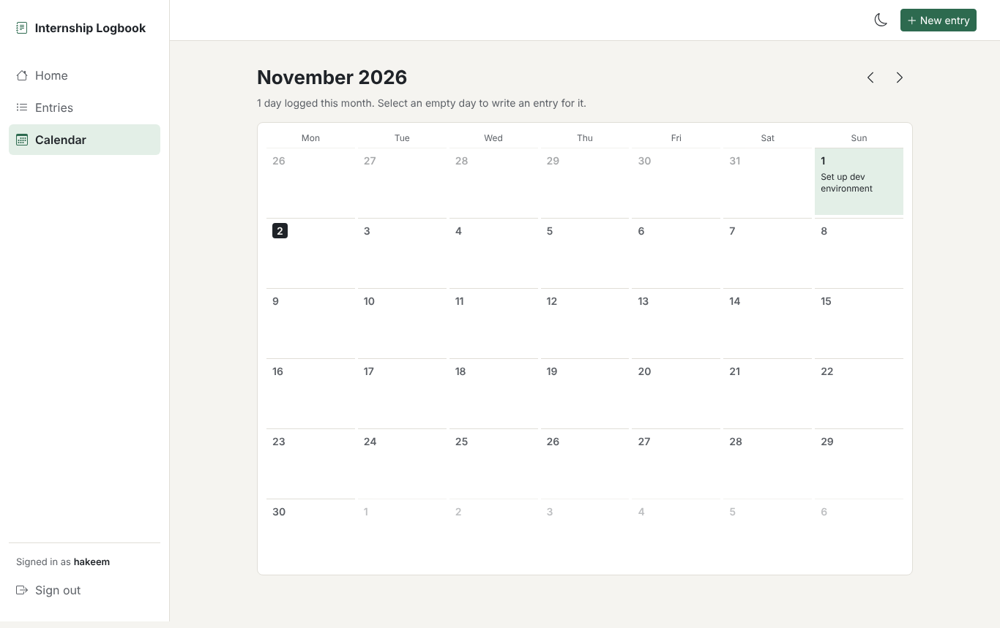

# Internship Logbook

This is a Flask web application I built to keep my internship work organised in one place. Instead of writing daily work notes manually, I wanted a simple way to record what I did, keep activities in time order, and look back at my progress.

## What it does

The app lets each user create a personal internship logbook. A daily entry can include a title, a list of activities with start and end times, and extra remarks. Entries can be searched, viewed in a calendar, printed, or exported as a PDF.

## Main features

- User registration and login
- One logbook entry per day for each user
- Add, edit, delete, and reorder daily activities (drag the handle, or focus it and use the arrow keys; reordering is desktop only for now)
- Rich-text remarks for extra details
- Home page that shows if today is logged and which days this week have entries, so missed days are easy to spot
- Total hours for each day, worked out from the activity times
- Searchable entry list (titles, activities, and remarks) and a monthly calendar view
- Print-friendly entry page and PDF export
- Responsive layout with light and dark mode (follows the system setting until you pick one)

## Screenshots

Screenshots can be added here before publishing, for example:

| Dashboard | Entry editor | Calendar |
| --- | --- | --- |
|  |  |  |

## Built with

- Python and Flask
- SQLite and SQLAlchemy
- Flask-Login and Flask-WTF
- Bootstrap 5, HTML, CSS, and JavaScript
- Bleach for safe rich-text remarks
- ReportLab for PDF export

## Project structure

```text
internship_logbook/
├── src/              # Flask application, routes, forms, and models
├── static/           # CSS and JavaScript
├── templates/        # HTML templates
├── .env.example      # Required environment-variable template
├── requirements.txt  # Python packages
└── README.md
```

## How to run it

1. Create and activate a virtual environment.

   ```powershell
   py -m venv .venv
   .\.venv\Scripts\Activate.ps1
   ```

2. Install the required packages.

   ```powershell
   pip install -r requirements.txt
   ```

3. Create your local environment file from the example.

   ```powershell
   Copy-Item .env.example .env
   ```

   Open `.env` and replace the `SECRET_KEY` placeholder with a long random value. This file is ignored by Git, so it will not be uploaded.

4. Start the app.

   ```powershell
   flask --app src.main run --debug
   ```

5. Open `http://127.0.0.1:5000`, register an account, and create your first entry.

## Database

The app creates `internship_logbook.db` automatically the first time it runs. The database is only for local use and is ignored by Git, so personal logbook entries will not be included when this project is uploaded.

## Future improvements

- Export entries for a selected date range
- Upload supporting files or photos
- Add supervisor review and approval
- Add reminders for days without an entry

## License

This project is licensed under the [MIT License](LICENSE).


## Author

Abdul Hakeem bin Mohamad Nazri
